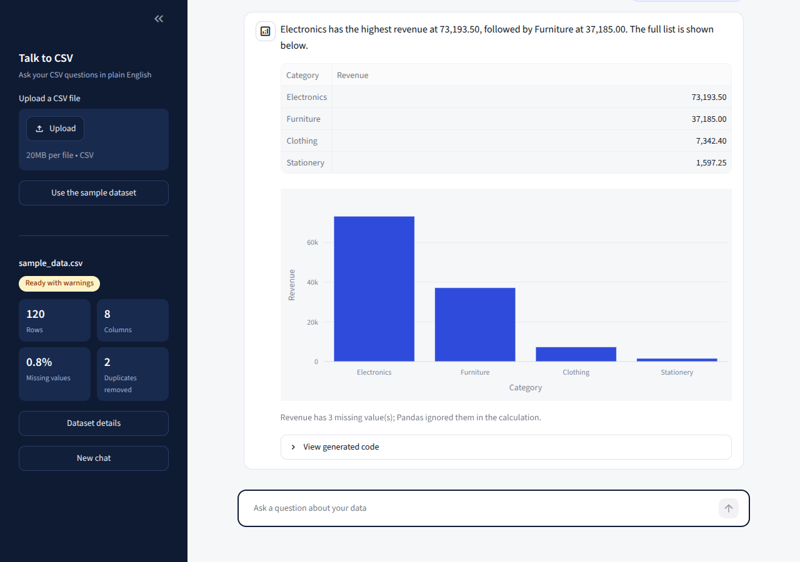
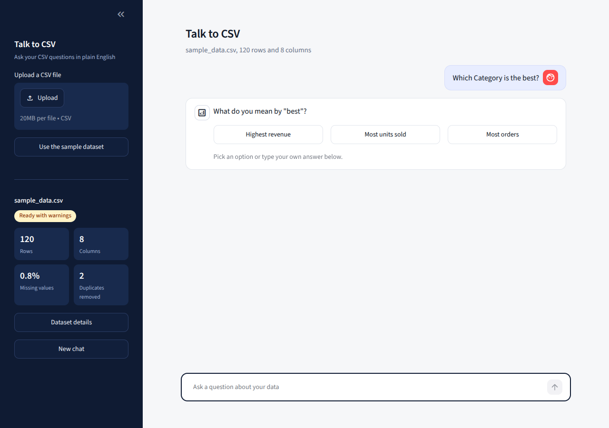

# Talk to CSV

**Talk to CSV** is a Streamlit chat app (an AI data analyst) where a business user uploads a CSV file and asks questions about it in plain English. An LLM (Gemini, Groq, OpenRouter or Hugging Face, your choice) decides what to do; **Pandas does all the real calculating**; every piece of generated code is checked before it runs. If the question is unclear, the agent asks for clarification first and then answers correctly.

**Target user:** a business user who has a CSV (orders, sales, inventory) but cannot write Pandas.



## Features

- Chat interface with a data sidebar, suggested questions and answer cards
- **Natural answers:** the reply is a normal sentence ("Omar has the highest salary, 2,200."), not a raw table
- CSV upload with validation (wrong type, empty file, duplicate column names, unreadable file)
- Deterministic Data Quality layer (missing values, exact duplicates, type conversion) with a report and a status: `READY`, `READY_WITH_WARNINGS`, `REJECTED`
- Natural-language questions: count, filter, average, sum, grouped comparison, top N, sorting, time-based analysis
- **Multi-step clarification:** unclear question -> clarification question with options -> final answer
- Reports missing columns and unsupported questions clearly
- Safe execution: AST validation + whitelist + restricted globals
- Automatic recovery from execution errors (max 2 correction attempts)
- Plotly chart chosen from the shape of the real result

## Architecture

```text
Upload CSV -> File validation -> Data Quality layer -> cleaned_df (original_df kept untouched)
                                                          |
User question (+ earlier clarification answers) + schema + quality summary
   -> LLM -> JSON decision
   |-- ask_clarification -> question + options shown in chat -> user answers -> back to the LLM
   |-- unsupported / missing column -> clear message
   '-- generate_code -> AST validation -> restricted execution -> result
                              |  error? -> send error to LLM -> new code -> validate again (max 2x)
                              v
                     number / table + chart shown in chat
```


| File                                                                               | Responsibility                                                                                                |
| ---------------------------------------------------------------------------------- | ------------------------------------------------------------------------------------------------------------- |
| `answer_writer.py`                                                 | Turns the real result into a short natural sentence, and checks that every number in it comes from the result |
| `app.py`                                                                           | Streamlit app: page flow, chat state, clarification state                                                     |
| `ui.py`                                                                            | Look and feel: styles, sidebar, suggested questions, answer cards                                             |
| `full_system.py`                                                                   | Orchestration: question -> LLM -> decision -> validate -> execute -> retry                                    |
| `list_models.py`                                                                   | Prints the model names available for your key                                                                 |
| `llm.py`                                                                           | LLM connection (OpenAI-compatible client) and clear error messages                                            |
| `prompts.py`                                                                       | All prompts (decision, clarification, correction)                                                             |
| `data_quality.py`                                                                  | Deterministic checks/cleaning and the Data Quality Report                                                     |
| `code_validator.py`                                                                | AST validation and all whitelists (one clear place)                                                           |
| `code_exec.py`                                                                     | Restricted execution on a copy of the data                                                                    |
| `helper.py`                                                                        | JSON extraction, schema, result formatting, chart selection                                                   |
| `config.py`                                                                        | Thresholds, limits, LLM provider presets                                                                      |
| `.streamlit/config.toml`                                       | Theme (colors, fonts) and upload limit                                                                        |
|                                                                                    |                                                                                                               |

## Installation

```bash
python -m venv venv
venv\Scripts\activate          # Windows   (Mac/Linux: source venv/bin/activate)
pip install -r requirements.txt
```

### Choose a free LLM provider

The app works with any provider that supports the OpenAI format. These have a free plan without a credit card (limits change, check each provider's page):


| Provider                     | Get a key        | `LLM_PROVIDER` | Key variable         |
| ---------------------------- | ---------------- | -------------- | -------------------- |
| Google Gemini (default)      | Google AI Studio | `gemini`       | `GEMINI_API_KEY`     |
| Groq                         | console.groq.com | `groq`         | `GROQ_API_KEY`       |
| OpenRouter (`:free` models)  | openrouter.ai    | `openrouter`   | `OPENROUTER_API_KEY` |
| Hugging Face (needs credits) | huggingface.co   | `huggingface`  | `HF_API_KEY`         |

Create a `.env` file (see `.env.example`), for example:

```
LLM_PROVIDER=gemini
GEMINI_API_KEY=your_gemini_key_here
```

To use another model from the same provider, add `LLM_MODEL=model-name`.

## Run

```bash
streamlit run app.py
```

Click **Use the sample dataset** to try `sample_data.csv` (120 rows after cleaning; columns Product, Category, Price, Quantity, Revenue, Date, Region, Status; a few missing values and 2 duplicate rows on purpose).

## Example questions


| Question                                | Expected behavior                                 |
| --------------------------------------- | ------------------------------------------------- |
| How many rows are there?                | A number                                          |
| What is the average price?              | A number                                          |
| Which category has the highest revenue? | Grouped table + bar chart                         |
| Show the top 5 products by revenue.     | Table + bar chart                                 |
| Compare revenue between regions.        | Table + bar chart                                 |
| Show monthly revenue over time.         | Line chart                                        |
| Which product is the best?              | **Clarification** (revenue, quantity or orders?)  |
| What is the average salary?             | **Missing column** message with available columns |
| Predict next year's revenue.            | **Unsupported** message                           |

## Data Quality layer (runs before the AI)

The LLM never decides how to clean data. Rules (all in `config.py`):

- **Missing values:** reported per column. Over 10%: clearer warning; over 30%: high-missingness; over 50%: unreliable column (the LLM is told to avoid it); over 40% of the whole dataset: `REJECTED`. Values are never filled or invented.
- **Duplicates:** exact duplicate rows only. Removed; over 10% adds a warning; over 20% is `REJECTED`.
- **Types:** text columns are converted to numeric/date only if at least 90% of values convert. Between 20% and 90% the column is flagged as mixed and left unchanged.
- **Empty columns** are removed and reported. **Duplicate column names** reject the file (Pandas would rename them silently, so the header is checked first).
- `original_df` is never modified; analysis uses `cleaned_df`.

## LLM workflow

The model receives the question, schema (names, dtypes, missing counts), 3 sample rows, the quality summary and the allowed methods. It must answer with JSON only:

```json
{"action": "generate_code", "code": "result = df['Price'].mean()", "explanation": "Average of the Price column"}
{"action": "ask_clarification", "clarification_question": "What do you mean by best?", "options": ["Highest revenue", "Most units sold", "Most orders"]}
{"action": "unsupported", "reason": "This question requires prediction..."}
{"action": "unsupported", "reason": "column not found", "missing_column": "salary"}
```

Temperature is 0 so the same question gives the same analysis process. **Numbers never come from the LLM**: they come from executing the code on the real DataFrame.

## Clarification flow

When a question has more than one reasonable meaning (for example "Which category is the best?") or misses an important detail, the agent does not guess. It asks **one short question** and offers quick-reply buttons. The user clicks an option or types an answer, then the agent answers the **original question** using that clarification.




- The original question, the agent's question and the user's answer are all sent to the model in the next call.
- Maximum 2 clarification questions per question (`MAX_CLARIFICATIONS` in `config.py`). After that the agent must choose the most reasonable meaning.
- If the user types a completely new question instead of an answer, the model answers the new question.
- Clear questions are answered directly, with no extra questions.

## AST security layer

Generated code goes through three layers, in order:

1. **AST validation** (`ast.parse`, never executed at this stage): only whitelisted syntax nodes; no imports, loops, lambda, functions, classes; dangerous names blocked (`open`, `eval`, `exec`, `compile`, `__import__`, `getattr`, ...); any attribute starting with `_` blocked; `inplace=True` blocked; `**` blocked.
2. **Whitelist:** only listed Pandas methods/attributes (`mean`, `groupby`, `sort_values`, `nlargest`, ...). File operations (`to_csv`, `read_csv`, ...) and `query`/`apply` are blocked.
3. **Restricted globals:** `exec` runs with only `df` (a copy), `pd` and a handful of safe builtins.

> **Limitation:** this is a restricted execution layer, **not a perfect security sandbox**. It also has no time limit, so a very heavy Pandas operation could be slow. For production use, run code in an isolated process or container.

## Charts

Chosen from the real result: comparison -> bar, over time -> line, distribution -> histogram, shares (few categories) -> pie, two numeric columns -> scatter. Scalars get no chart. Axes are labeled with column names.

## Natural answers

After Pandas calculates the result, a second short LLM call writes the answer as a normal sentence in the language of the question. The numbers still come only from Pandas:

- The model sees only the real result (first 10 rows) and is told never to invent or change numbers.
- Every number in the sentence is checked against the result. If one is not found, or the call fails, the app uses a simple built-in sentence instead.
- A table is shown only when the result has more than one row. A single value or a single row is answered in the sentence only.
- Set `NATURAL_LANGUAGE_ANSWERS = False` in `config.py` to skip this step and save one request per question (useful on a small free quota).
